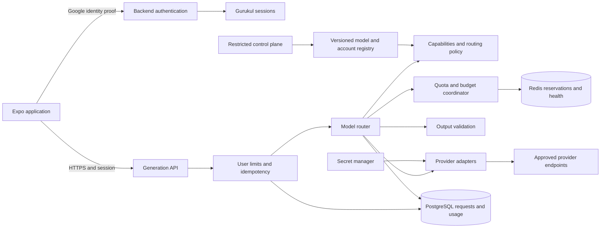
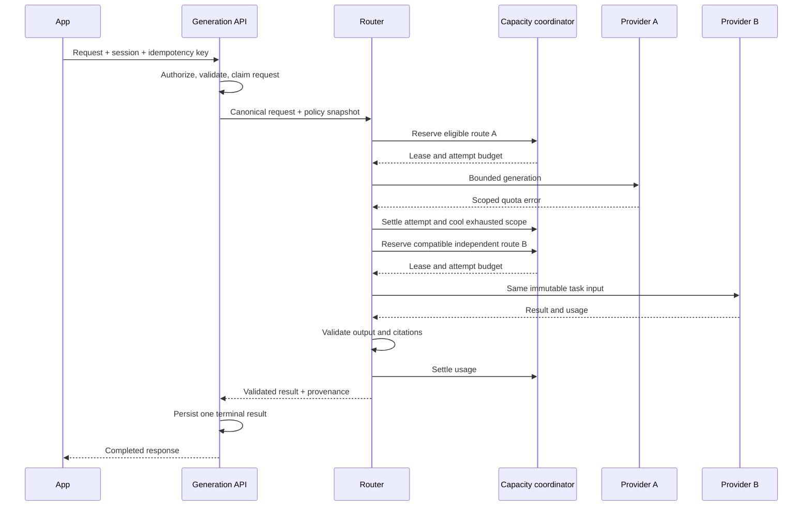

# Backend model router: high- and low-level design

Date: 2026-10-08. Status: planned architecture; no backend, account provisioning, mobile integration or deployment implemented.

Owner: Gurukul backend. Planning scope: this document, [ADR-003](../decisions/ADR-003-cloud-model-router.md) and [project state](state.md). Written directly at the user's request, without the Gurukul planning skill.

## 1. Outcome and architectural boundary

Build one authenticated backend API that can send a generation request to OpenAI, Gemini, Groq, OpenRouter, NVIDIA, Kimi/Moonshot or DeepSeek through replaceable adapters. When an eligible route is unavailable, choose another permitted account/model/provider within the same request's capabilities, privacy policy, budget and deadline. Adding a provider must not require editing the routing algorithm.

Example: a Buddy reply prefers a configured Gemini model. Its project has exhausted daily capacity. The router excludes every credential sharing that exhausted quota, then selects another approved independent account or a compatible Groq model. If no eligible capacity remains, return a truthful capacity error and retry time where known. Never promise unlimited or universally free inference.

This is an explicitly requested online architecture extension. The running app remains phone-local: [BuddyManager](../../src/services/buddy-manager.ts) and [StudyManager](../../src/services/study-manager.ts) use the installed model through `StudyRuntime`; local SQLite stores history. There is no existing backend authentication or cloud generation service. Keep the [V1 baseline](../product/v1-spec.md) and [ADR-001](../decisions/ADR-001-offline-v1.md) as the current runtime specification until a separate implementation changes them. Do not disguise cloud generation as Ready Offline or automatically upload existing notes.

Assumptions: adult college cohort for the proposed cloud mode; Gurukul owns backend provider credentials; Google sign-in identifies users but supplies neither provider credentials nor personal provider quota. College enrollment alone does not establish age. Provider access, production rights, prices and quotas must be verified per configured account before enabling it.

## 2. Requirements and scope

| ID | Required behavior |
| --- | --- |
| MR01 | Verify Google identity on the backend; issue Gurukul sessions; authorize every request and persisted result against user/tenant ownership. |
| MR02 | Normalize messages, task requirements, results, usage, errors and streaming events behind provider-neutral ports. |
| MR03 | Support multiple authorized accounts per provider, multiple credentials per account and shared quota groups across credentials/models. |
| MR04 | Proactively admit requests against request/token/concurrency/budget limits and react to upstream throttling without retry storms. |
| MR05 | Fail over only to capability-, quality-, privacy-, region- and budget-compatible targets. |
| MR06 | Enforce one deadline, bounded attempts, cancellation, idempotency and explicit interrupted-output behavior. |
| MR07 | Keep provider secrets server-side; audit route changes and account onboarding; redact prompts and credentials from telemetry. |
| MR08 | Validate structured results and citations; preserve source revisions and deterministic local quiz scoring. |
| MR09 | Provide distributed quota/budget accounting, scoped circuit breakers, traceable route decisions and safe degraded operation. |
| MR10 | Onboard a new provider with an adapter, registry configuration and contract evidence, without changes to the core router. |

First implementation: text-only, buffered Buddy requests, Google authentication, one route policy, PostgreSQL and Redis, two adapters, then all seven adapters incrementally. Existing local processing remains an explicit mode. Follow with source-grounded Study and validated quizzes; streaming is a later bounded slice.

Excluded initially: automatic creation of provider accounts, recycling trial identities, tools with external side effects, images/audio/OCR uploads, embeddings, cloud notebook sync, semantic answer caching, agent execution, dynamic model marketplaces, automated model-based routing and Kubernetes/microservice decomposition. Adapter capability contracts allow future modalities without claiming them now.

Multiple accounts are admitted only when their use and capacity pooling are authorized for Gurukul's workload. Several keys under one organization/project do not imply several quotas. Exhaustion of a shared quota blocks that whole group. If independent account capacity is not verified, treat the accounts as sharing the limiting pool until verified. This is a routing and availability design, not a mechanism for manufacturing free-tier entitlement.

## 3. High-level design



Use a modular backend service with a separate worker process from the same codebase for expired leases, usage reconciliation and configuration refresh. PostgreSQL is durable authority for identities, request state, accounting and configuration; Redis coordinates short-lived admission, locks, counters and health across API replicas. No provider network call occurs inside a database transaction.

Separate the data plane (user inference) from the control plane (provider/account/model configuration). The router uses a validated immutable configuration snapshot and records its version on each request. Admin updates have audit history, optimistic version checks and rollback. Credential revocation and emergency account/provider disable flags take effect even for requests using an older snapshot, before every new attempt. An emergency stop also cancels active upstream work best-effort.

### Components and responsibilities

| Component | Single responsibility |
| --- | --- |
| `AuthService` | Verify identity, manage sessions, resolve tenant and user. |
| `GenerationController` | Validate HTTP input, bind identity, propagate deadlines/cancellation, serialize outcomes. |
| `RequestCoordinator` | Idempotency ownership, request state transitions and terminal result persistence. |
| `RequirementResolver` | Translate product task profiles into required capabilities and server-controlled limits. |
| `CandidateFilter` | Remove disallowed, incompatible, unqualified or disabled routes. |
| `RoutingStrategy` | Rank eligible routes using configured priorities and observed health/cost/latency. |
| `CapacityCoordinator` | Atomically reserve hierarchical quota, concurrency and spend before dispatch. |
| `AttemptExecutor` | Execute exactly one adapter attempt; apply deadline and normalize outcome. |
| `FailurePolicy` | Decide whether a normalized failure permits retry, failover, cooldown or termination. |
| `CircuitBreakerStore` | Track scoped outage state and coordinate limited half-open probes. |
| `OutputValidator` | Validate task structure and allowed source references independently of providers. |
| `ProviderRegistry` | Resolve adapters and account/model metadata; no provider selection decisions. |
| `UsageLedger` | Persist reservations, settlements and unknown charges; reconcile actual usage. |
| `Telemetry` | Record bounded operational metrics and redacted route/attempt traces. |

### Google sign-in and ownership

Use platform-supported Google sign-in/authorization and a backend identity-proof exchange. Backend verification checks signature against cached trusted Google keys, issuer, allowed client audience, expiry and nonce where the chosen flow provides one. Bind accounts by Google's stable `sub`, not a mutable email address; require email verification if email is used for contact. Do not request Gmail mailbox scopes.

Exchange the verified proof for short-lived Gurukul access tokens and rotating refresh sessions. Refresh-token reuse revokes the session family. Store server refresh tokens as hashes and mobile session secrets in platform secure storage. Do not accept a client-supplied tenant ID as authorization. Session logout revokes the session; offline local workspace management remains separately defined. OAuth client IDs, bundle/package identifiers and redirect configuration are implementation dependencies.

Sign-in itself must not submit any content to a provider. Cloud generation requires a recorded consent version and a route policy matching that consent. Default planning policy: only verified no-training routes may receive private study content. Any unpaid/training-enabled experiment is synthetic-data-only until product eligibility and consent are resolved. Google's unpaid-service terms impose data-use and age requirements; being a college app does not remove those requirements. [Google terms](https://ai.google.dev/gemini-api/terms)

### Request sequence



## 4. Domain model: credentials are not capacity

Selection unit: `RouteTarget = provider + endpoint + model + account + credential + upstream restrictions`.

| Entity | Important fields and semantics |
| --- | --- |
| `Provider` | Stable ID, adapter ID/version, enabled flag, protocol family, failure domain. |
| `Endpoint` | Server-approved base URL, API version, region, production/trial environment, TLS/egress policy. |
| `ProviderAccount` | Provider organization/project identifiers, owner, commercial entitlement, environment, permitted tenants, status. |
| `Credential` | Account ID, secret reference/version, status, expiry; contains no independent quota assumption. |
| `ModelOffering` | Provider/endpoint model ID, revision if available, capabilities, context/output limits, pricing version, quality evidence. |
| `QuotaGroup` | Provider-defined scope and dimension, limit/window/reset rules, evidence source, verification date. |
| `RouteBinding` | Account/model/endpoint/credential and all applicable parent quota groups, route allowlist and production eligibility. |
| `RoutingPolicy` | Task profile, ordered model preferences, limits, privacy/regions, fallback rules, version. |
| `Request` | User/tenant, idempotency key/hash, immutable requirements, policy version, status, deadline, winner. |
| `Attempt` | Request/ordinal, target, lease, upstream ID, dispatch timestamps, normalized outcome, usage certainty. |

A target can belong simultaneously to organization-wide RPM, project RPM, model-family TPM, account daily tokens, concurrency and spend groups. Every applicable group must admit the attempt. Keys belonging to the same account reference the same relevant groups. Account selection cannot bypass parent limits. Model aliases sharing upstream capacity must also reference the common group.

OpenRouter is both a provider-facing adapter and an aggregator: retain broker, actual upstream provider/model where returned, and configured upstream restrictions. If OpenRouter uses a Gurukul-owned direct-provider key through BYOK, link both paths to the same direct quota groups. When independence of broker capacity is unknown, do not assume it provides fresh capacity after a direct route exhausts. Do not send the same request through an opaque default aggregator fallback when privacy or failure-domain policy requires an explicit upstream.

## 5. Low-level contracts

Proposed TypeScript contracts below define behavior, not implemented code or installed dependencies. Core interfaces use ordinary data, clocks and `AbortSignal`; concrete SDK types stay inside infrastructure adapters.

```ts
type ProviderId = string; // extensible: not a closed enum of seven providers
type Task = 'buddy.chat' | 'study.answer' | 'study.summary' | 'quiz.generate';
type Capability = 'text' | 'json-schema' | 'stream' | 'vision' | 'tools';

interface CanonicalMessage {
  role: 'system' | 'user' | 'assistant';
  text: string;
}
interface Evidence {
  sourceId: string;
  revision: string;
  page: number;
  excerptId: string;
  text: string;
}
interface GenerationRequest {
  requestId: string;
  task: Task;
  messages: readonly CanonicalMessage[];
  evidence: readonly Evidence[];
  schema?: Readonly<Record<string, unknown>>;
  maxOutputTokens: number;
  requiredCapabilities: readonly Capability[];
  policyVersion: string;
  deadlineAtMs: number;
}
interface Usage {
  inputTokens?: number;
  outputTokens?: number;
  cachedInputTokens?: number;
  reasoningTokens?: number;
  chargedMicros?: bigint;
  currency: string;
  certainty: 'reported' | 'estimated' | 'unknown';
}
interface ProviderResult {
  text: string;
  finish: 'complete' | 'length' | 'refusal' | 'unknown';
  usage: Usage;
  upstreamRequestId?: string;
  actualModel: string;
  actualProvider?: string;
}
interface AttemptContext {
  target: RouteTarget;
  credential: SecretHandle; // ephemeral; never JSON-serialized
  attemptId: string;
  signal: AbortSignal;
  deadlineAtMs: number;
}
interface GenerationAdapter {
  readonly id: ProviderId;
  readonly version: string;
  estimate(request: GenerationRequest, target: RouteTarget): UsageEstimate;
  generate(request: GenerationRequest, ctx: AttemptContext): Promise<ProviderResult>;
  normalizeError(error: unknown, ctx: AttemptContext): RouterFailure;
}
interface StreamingAdapter {
  stream(request: GenerationRequest, ctx: AttemptContext): AsyncIterable<ProviderEvent>;
}
interface CapacityPort {
  reserve(input: ReservationInput): Promise<Admission>;
  markDispatched(leaseId: string, attemptId: string): Promise<void>;
  settle(leaseId: string, outcome: AttemptOutcome): Promise<void>;
  renew(leaseId: string): Promise<void>;
}
interface RoutingStrategy {
  rank(candidates: readonly RouteTarget[], state: RouteSnapshot): readonly RouteTarget[];
}
interface FailurePolicy {
  decide(failure: RouterFailure, state: RequestExecution): FailureDecision;
}
```

`RouteTarget`, `UsageEstimate`, `SecretHandle`, `ReservationInput`, `Admission`, `AttemptOutcome`, `ProviderEvent`, `RouterFailure`, `RouteSnapshot`, `RequestExecution` and `FailureDecision` are domain types to implement with runtime validation. `RouteTarget` contains IDs and non-secret metadata; secret handles are passed only to the selected adapter. `Admission` is a discriminated success/denial result with lease ID or scope/reason/optional reset time. Usage money is integer micro-units internally and decimal strings over JSON, never floating-point arithmetic or JSON `bigint`.

`RouterFailure` carries `kind`, `scopeType`, optional scope IDs/dimensions, `retryAfterMs`, `dispatchState` (`not-sent`, `rejected`, `possibly-accepted`), usage certainty and a redacted upstream code. `FailureDecision` is one of `stop`, `try-next`, or `wait-and-retry`, with explicit affected scopes and delay. Numeric HTTP status alone is insufficient to decide.

Adapters must not select accounts, apply product policy, persist user answers or implement their own retry loops. Each invocation is one transport attempt; disable SDK retries and aggregator fallback by default. A shared transport library may implement authentication/header construction and bounded response decoding, but provider-specific error, token and schema semantics remain in each adapter.

### API surface

| Endpoint | Contract |
| --- | --- |
| `POST /v1/auth/google` | Verify platform identity proof; return Gurukul session. |
| `POST /v1/auth/refresh` | Rotate refresh session; detect replay. |
| `POST /v1/auth/logout` | Revoke session family; no local notebook deletion. |
| `POST /v1/generations` | Auth + `Idempotency-Key`; task, messages, optional evidence and approved task options; return buffered terminal result. |
| `GET /v1/generations/{id}` | Owner-only request status/result, including interrupted or pending. |
| `POST /v1/generations/{id}/cancel` | Owner-only idempotent cancel request; best-effort upstream cancellation. |
| `GET /internal/health/live` | Process liveness; no provider call. |
| `GET /internal/health/ready` | Required data/coordination dependencies and usable validated configuration. |

Successful generation: `{requestId, status: 'completed', result, provenance, usage}`. Provenance includes route policy/prompt/schema versions, chosen provider, actual model/revision when known, source manifest hash and validated citations. Never invent a revision that the provider does not disclose. Public provenance excludes secret/account identifiers.

Error envelope: `{requestId, code, message, retryAt?, retryable}`. Invalid input is 400; unauthenticated 401; forbidden ownership/consent 403; idempotency-key/body mismatch or active duplicate 409; user rate limit 429; unavailable compatible capacity 503; exhausted user spend allowance 429 with `USER_BUDGET_EXHAUSTED`; deadline 504; invalid upstream output 502. HTTP 499 is log-only for a disconnected client. Upstream account configuration failures are server errors, not user authentication failures. Return `Retry-After` only when the delay is meaningful. Do not expose upstream messages, stack traces or keys.

Client-supplied provider IDs, URLs, account IDs, prices, system policies and quota scopes are rejected. Derive these from server task profiles and registry configuration. Set explicit body/message/output limits and validate schemas before any network dispatch. The backend assembles trusted system instructions; source text and user messages remain untrusted data. Evidence IDs from a client are a request-scoped allowlist, not proof of ownership of a server-hosted document; cloud notebook sync would require separate ownership verification.

## 6. Routing algorithm

Use deterministic policy rules initially. Avoid an extra model call to decide where another model call should go.

1. Authenticate, validate consent/task limits and claim the idempotency key. Resolve the task requirements and approved model tiers.
2. Pin the request's content, source manifest and policy snapshot. Never change evidence, language, output schema or task semantics during fallback.
3. Build candidate targets; filter production entitlement, permitted tenant, data-use/region, capabilities, context fit, quality evidence, active credentials, emergency disables and failed/cooling scopes.
4. Rank: configured task/model tier first; within a tier use priority, predicted deadline fit, cost class, recent success/latency and remaining verified capacity. Tie-break by a deterministic hash of request ID and route ID to spread traffic. Explicit policy can prefer free eligible offerings, but cannot silently exceed a free-only budget.
5. Atomically reserve applicable quota/concurrency groups, then durably authorize attempt spend through the reservation saga described below. If another replica wins the remaining capacity, try the next candidate without making an upstream call. Compensate undispatched reservations on failure.
6. Persist the attempt/reservation, resolve its secret, recheck cancellation and emergency disables, then mark dispatch conservatively before the network write.
7. Execute one adapter call within the remaining request deadline. Record upstream identity and usage; validate complete output before choosing a winner.
8. Settle accounting and finalize one response. On failure, classify it, update only the affected scopes, and either stop, take another eligible target, or wait within the deadline.
9. Stop on cancellation, validation/policy refusal, request deadline, attempt/spend ceiling or no eligible targets. Finalize an honest failure; never fabricate a successful answer.

Within a provider, another account may be used only if all exhausted ancestors are independent and its entitlement permits the workload. Credentials sharing a blocked group are skipped together. Provider-wide outages skip the whole provider even if other account credentials exist. Ordered provider preference is configurable per task, not a hard-coded global OpenAI → Gemini → Groq chain; different tasks can require different model tiers.

Illustrative defaults, subject to measurement: 60-second whole-request deadline, 15-second time-to-first-token ceiling where streaming exists, 3 upstream attempts total, at most 1 retry on the same target, and capped exponential backoff with full jitter. Each provider/model can have a different attempt timeout within the common deadline. Do not impose the illustrative first-token ceiling on a nonstreaming adapter that cannot observe first token. Shorten attempts when insufficient total deadline remains. No parallel hedging in the first version.

Admission denials do not consume upstream attempt count, but candidate examination and reevaluation are bounded. A queue wait, if enabled, has a fixed length and deadline; the first version returns capacity errors rather than storing an unbounded queue of student content.

### Failure decision table

| Failure | State change | Routing action |
| --- | --- | --- |
| Temporary RPM/TPM/concurrency 429 | Cool reported quota scope; honor valid reset/Retry-After evidence. | Compatible independent target, or bounded wait if deadline permits. |
| Daily/monthly quota exhausted | Exhaust applicable group until authoritative reset; unknown reset stays blocked pending refresh. | Independent eligible group/provider; no retry on sibling key. |
| Balance/credit exhausted (402 or provider-specific 429) | Mark relevant account/billing group unavailable; alert. | Independent funded target inside budget; never label this a short throttle. |
| Credential invalid/expired | Disable that credential; audit/alert. | Another valid authorized credential may be used if account remains permitted. |
| Account permission/policy ban | Disable appropriate account; alert. | Do not switch identities to evade enforcement; stop affected workload. |
| Transport timeout / ambiguous dispatch | Retain unknown-charge reservation; mark availability health. | Text-only failover permitted within remaining budget; record possible duplicate upstream cost. |
| Upstream overload/5xx | Increment scoped breaker failure count. | Eligible alternate route; bounded same-target retry only if useful. |
| Invalid input/context too large | Preserve caller error, or quarantine stale model-capability entry when registry is wrong. | No blind fallback/truncation; reject input or explicitly select a verified larger-context target before dispatch. |
| Moderation/policy refusal | Persist safe terminal refusal. | Do not route to another provider to bypass refusal. |
| Malformed structured output | Record quality failure; expose nothing as completed. | At most one compatible regeneration within the overall 3-attempt ceiling, if the task policy allows. |
| Cancelled/deadline exceeded | Cancel upstream best-effort; settle conservatively. | Stop immediately; discard late output. |

Malformed response repair is not allowed to alter citation allowlists or correct answers silently. A schema-valid result can still be factually wrong; separate task evaluations qualify a model tier. The router does not establish educational accuracy.

## 7. Quota, budget and concurrency coordination

### Atomic admission

Reserve estimated input tokens plus the full configured output allowance, one request unit, one concurrency slot, and worst-case attempt cost. Account for reasoning/cached-token charging according to provider/model metadata. If a trustworthy token counter is unavailable, use a documented conservative estimator and margin. Unknown context limits or prices make a route ineligible for strict-limit policies. Provider accounting can charge request limits using requested maximums or rejected attempts; adapter settlement rules must reflect verified semantics rather than blindly refunding unused tokens/requests.

Quota dimensions support rolling buckets/token buckets for short windows, provider-defined fixed daily resets and model-family pools. Use UTC storage and provider reset metadata; do not assume every provider resets at local midnight. Validate and cap upstream reset headers. Header observations may reduce availability immediately; only newer, authoritative evidence may increase it. Local accounting is a conservative admission layer, not a replacement for provider counters or external workload reconciliation.

All scopes for a reservation must be checked and updated atomically in Redis. Initial deployment uses one logical Redis primary; replicas of the API share it. If sharding is introduced, colocate all reservation keys on a coordination shard or redesign with a transactional coordinator. Do not claim a cross-slot Redis script can atomically reserve arbitrary groups. A failed reservation changes no counters.

Use lease IDs, attempt IDs and fencing tokens. Releases and settlements are idempotent. Renew concurrency leases while an attempt is active. A lease expiry does not refund consumed rate quota or dispatched spend. After worker death, hold uncertain upstream concurrency through the maximum attempt window plus a safety grace period, then reconcile; upstream cancellation is never assumed successful. Requests reserve each new attempt's cost in addition to prior uncertain costs. A 3-attempt request must fit its worst-case cumulative budget before later dispatches.

### Durability and reconciliation

PostgreSQL holds tenant/user/app budget balances and reserved charges under row locks/transactional updates. Create a durable attempt/spend reservation before dispatch. Redis quota admission and PostgreSQL spend are separate systems: use an explicit reserve saga, not a pretend cross-store transaction. If quota succeeds but spend/persistence fails, release the undispatched quota lease. If the process crashes in between, an expiry worker releases the undispatched reservation. No dispatch occurs before durable spend authorization and a recorded quota lease.

Mark an attempt as dispatching conservatively before sending; a crash after that mark is treated as possibly accepted even if no bytes actually left. A completed provider call with a failed ledger write is recorded/reconciled as uncertain and must not trigger automatic regeneration. Transactionally record the attempt result, budget settlement and request winner in PostgreSQL; release Redis concurrency idempotently afterward. On crash, the worker completes pending releases. Metered rate consumption follows provider rules and remains even when no answer is published.

Unknown charges remain reserved until provider usage evidence or an explicit operator resolution; never erase them on timeout. An unavailable balance API requires manual reconciliation and a bounded unresolved-spend threshold that pauses further dispatch. Reconcile usage by provider request ID and pricing version, including cached input, reasoning, output and broker fees where applicable. Do not promise exactly-once upstream execution or billing.

For recovery, each saga stage has a persisted state or an expiring Redis lease tied to a stable attempt ID. A request worker needs both its current fencing token and an unexpired admission lease immediately before dispatch. Losing either prevents dispatch. A lease that expired before network dispatch is released; one that expired after the dispatch marker is treated as possibly accepted. The expiry worker cannot settle an attempt concurrently with a valid newer request owner; ledger/state transitions use fencing and compare-and-set.

Redis loss or restart: stop new dispatch, keep durable unknown spend, rebuild only conservative counters, and wait through applicable windows or refresh authoritative quota observations before resuming. PostgreSQL/secret manager/critical policy failure also stops cloud dispatch. A cached config snapshot can survive a control-plane outage, but it cannot override missing revocation state or budget authority. Treat liveness separately from readiness.

### Circuit breakers and bulkheads

Availability breaker: `CLOSED → OPEN → HALF_OPEN → CLOSED`, scoped by provider endpoint/model and account where failure evidence is account-specific. Proposed initial threshold: 5 availability failures within 30 seconds, open for 30 seconds, one distributed half-open probe. These values are tuning hypotheses. Throttles update quota cooldowns; invalid user input, cancellation and refusals do not trip outage breakers. Keep quality quarantine separate from availability health.

Per-provider/account concurrency pools, per-user limits and tenant/app budgets isolate noisy users and outages. Scheduled probes use synthetic content and count against quota/spend; liveness endpoints never generate answers. Use a small bounded probe budget and stagger recovery to prevent a herd at reset time.

## 8. Idempotency, streaming and cancellation

Idempotency uniqueness is `(tenant_id, user_id, endpoint, idempotency_key)`. Store a keyed hash of the canonical body; mismatched reuse returns 409. A unique database constraint claims execution and a fencing token protects recovery. Active duplicate requests return the existing request ID/status; completed duplicates return the stored result during its retention window without new upstream dispatch.

Request states: `accepted → running → completed | failed | cancelled | interrupted`. Attempt states: `reserved → dispatching → succeeded | failed | cancelled | unknown`. Terminal transitions use compare-and-set and winner uniqueness. After a crashed worker with potentially dispatched work, mark the request interrupted rather than transparently rerunning it. A user retry is a new request/key; it can cause another upstream charge and must be disclosed. Do not promise exactly-once generation across disconnects and providers.

Initial buffered mode validates the whole answer before returning it. A lost response can be recovered by owner-only GET. A failed persistence step after provider success returns a recoverable server failure/interrupted state, not a retry signal that blindly creates another generation. Late provider results cannot overwrite a cancelled or completed request.

Future streaming contract: ordered SSE events `accepted`, `attempt-started`, `delta`, `completed`, `interrupted`, `failed`; include request ID, attempt ID and sequence number. Before any answer delta is visible, an eligible failover may start a new attempt. After a visible delta, mark interruption and require an explicit restart; never concatenate two providers' partial answers. Structured study/quiz output remains buffered until validation even if upstream transport streams. Ordinary Buddy text can stream only with a defined partial-output and moderation policy. Cancellation propagates through HTTP transport, adapters and lease handling; upstream may still finish and charge. Reconnection reads stored status/result; replaying partial SSE is deferred until a bounded event-retention design exists.

## 9. SOLID and design patterns

| Principle/pattern | Concrete application |
| --- | --- |
| Single responsibility | Routing ranks candidates; adapters translate protocols; accounting reserves capacity; validation controls publishable output. |
| Open/closed | Add an adapter factory and declarative route entries; no new provider branch inside the selection loop. |
| Liskov substitution | All adapters honor deadline/cancellation, normalized failures and usage certainty; no hidden retries or silent unsupported-feature downgrades. |
| Interface segregation | Separate buffered generation, streaming, health and future embedding/tool ports; no fake streaming method for providers without it. |
| Dependency inversion | Application depends on registry/capacity/ledger/clock/transport ports, injected at composition root. |
| Adapter / anti-corruption layer | Isolate provider payloads, streaming formats, error codes and token semantics. |
| Strategy | Exchange ordered priority, least-cost or latency-aware ranking without changing execution. |
| Chain of responsibility | Ordered candidate failover after policy filtering, with explicit stop conditions. |
| Factory / registry | Trusted composition root constructs named adapters; requests cannot load arbitrary modules. |
| State machine | Requests, attempts, credentials, quota cooldowns and circuit breakers have explicit allowed transitions. |
| Bulkhead / circuit breaker | Isolate concurrency and outage domains; recover using bounded probes. |
| Saga / transactional outbox | Compensate cross-store reservations; persist settlement/release work alongside durable state. |
| Decorator / middleware | Add telemetry and transport deadlines uniformly, without duplicating provider logic. |

Additional principles: composition over inheritance; DRY for protocol plumbing but not false provider equivalence; KISS/YAGNI through one service, buffered text and ordered policies first; fail closed on identity/consent/budget uncertainty; least privilege; immutable task input; explicit money/usage units; deterministic policy tests; bounded resource use; observable decisions; backward-compatible API/config versions.

Avoid a `UniversalProvider` with many boolean flags and provider-name conditionals. An OpenAI-compatible transport helper is reusable for some providers, but compatibility does not prove equivalent structured outputs, model capabilities, refusal behavior or quotas. A provider's optional control-plane quota API belongs to a separate port, not a mandatory method on every generation adapter.

## 10. Provider adapters and onboarding evidence

The table records integration considerations, not a promise of free access or measured model quality. Numeric quotas and model IDs remain configuration populated from the actual account and pinned to a verification date. Unknown production/privacy/quota properties disable the route by default.

| Provider | Adapter considerations | Capacity/eligibility gate |
| --- | --- | --- |
| OpenAI | Dedicated adapter for the chosen API family; normalize usage/refusals and explicit output limits. | Organization and project limits can share model-family capacity; credentials do not independently expand it. [Official rate limits](https://developers.openai.com/api/docs/guides/rate-limits) |
| Gemini | Native Gemini adapter; convert message/system/schema semantics; normalize quota dimensions and finish reasons. | Project-scoped limits, verified model tier, adult audience and acceptable data handling. [Rate limits](https://ai.google.dev/gemini-api/docs/rate-limits), [terms](https://ai.google.dev/gemini-api/terms) |
| Groq | Provider adapter with shared compatible transport where verified; model-specific schema/streaming gates. | Organization limits apply above credentials; project restrictions may further constrain them. [Rate limits](https://console.groq.com/docs/rate-limits), [projects](https://console.groq.com/docs/projects) |
| OpenRouter | Broker adapter; fix allowed upstreams, disable hidden fallbacks initially, retain actual upstream provenance. | Broker limits/credits plus upstream capacity and privacy restrictions; prevent double retry layers. [Limits](https://openrouter.ai/docs/api_reference/limits), [provider routing](https://openrouter.ai/docs/guides/routing/provider-selection) |
| NVIDIA | Distinguish hosted API Catalog from a separately entitled production NIM deployment; endpoint/model-specific contracts. | Hosted trial terms exclude production use; enable only internal evaluation routes or a verified production entitlement. [Quickstart](https://docs.api.nvidia.com/nim/docs/api-quickstart), [trial terms, sections 1.2–1.4](https://assets.ngc.nvidia.com/products/api-catalog/legal/NVIDIA%20API%20Trial%20Terms%20of%20Service.pdf) |
| Kimi / Moonshot | Adapter pins product/region/base URL; do not mix consumer, coding and Open Platform credentials. | Different 429 types mean overload, organization limits or insufficient balance; read the body rather than HTTP status alone. [Official troubleshooting](https://www.kimi.ai/help/kimi-api/api-troubleshooting) |
| DeepSeek | Dedicated adapter/configuration; verify current generation/reasoning/schema and billing semantics with live canaries. | Error-code documentation lists rate limiting; exact account limits, prices, production/privacy terms need onboarding verification. Page retrieval timed out during planning; indexed official material is preliminary. [Error codes](https://api-docs.deepseek.com/quick_start/error_codes/) |

Official references were consulted on 2026-10-08. No credentials were used and no live provider request or quota benchmark was performed. Kimi routing identity means its Open Platform inference service, not a consumer subscription. NVIDIA trial capacity is not proposed as a production fallback.

### Add any future provider

1. Record provider/product, account ownership, production entitlement, policy/region/data-use requirements and actual quota scopes. Unknown values remain disabled.
2. Implement `GenerationAdapter`; optionally implement separate streaming/health ports. Reuse verified transport code, not assumptions about provider behavior.
3. Register a trusted factory at the composition root, and add validated model/endpoint/account/credential bindings with secret references.
4. Run shared adapter contract fixtures: translation, limits, refusal, malformed JSON, partial SSE, cancellation, timeout, quota/auth/balance errors, usage and redaction.
5. Run authorized synthetic live canaries for the exact endpoint/model/account. Record adapter version, model identity, actual limits, latency, cost and production/privacy evidence.
6. Qualify task quality using a fixed corpus. Start disabled or shadow-only, then controlled canary traffic. Roll back configuration independently of code; emergency-disable the adapter if needed.

Definition of done: a new provider satisfies the same ports and evidence gates, can be registered without changing the core routing algorithm, and cannot become an unauthorized privacy/capability fallback.

### Configuration example

Illustrative fragments, deliberately disabled and using placeholder model IDs. Quota values come from verified account evidence; this example defines relationships, not usable capacity or secrets.

```yaml
configVersion: router-example-1
accounts:
  - id: gemini-account-a
    provider: gemini
    enabled: false
    entitlementEvidence: pending
  - id: gemini-account-b
    provider: gemini
    enabled: false
    entitlementEvidence: pending
credentials:
  - id: key-a1
    accountId: gemini-account-a
    secretRef: secret-manager/path-a1
  - id: key-a2
    accountId: gemini-account-a
    secretRef: secret-manager/path-a2
  - id: key-b1
    accountId: gemini-account-b
    secretRef: secret-manager/path-b1
quotaBindings:
  - credentials: [key-a1, key-a2]
    groups: [verified-project-a-daily, verified-project-a-model-tpm]
  - credentials: [key-b1]
    groups: [verified-project-b-daily, verified-project-b-model-tpm]
policies:
  - id: buddy-adult-private
    task: buddy.chat
    requiredCapabilities: [text]
    dataUse: verified-no-training
    maxAttempts: 3
    deadlineMs: 60000
    preference:
      - provider: gemini
        model: configured-qualified-model
      - provider: groq
        model: configured-qualified-fallback
```

Exhausting `verified-project-a-daily` excludes both `key-a1` and `key-a2`. `key-b1` is considered only after its independently verified bindings and any shared parent groups admit it. Groq is considered only when its separately configured offering satisfies the same policy. Complete configuration also needs quota limits/reset evidence, region, prices/budgets, model capabilities/context/quality, endpoint allowlists and permitted tenants. Incomplete fragments fail runtime configuration validation and cannot be enabled.

## 11. Storage, security and observability

Proposed PostgreSQL tables: `users`, `identity_links`, `sessions`, `provider_accounts`, `credential_refs`, `model_offerings`, `quota_groups`, `route_bindings`, `routing_policies`, `generation_requests`, `generation_attempts`, `budget_reservations`, `usage_entries`, `outbox_events`, `config_audit`. Explicit migrations and unique constraints preserve existing backend records. These tables are a new backend database; do not migrate or overwrite mobile SQLite tables as a shortcut.

Critical indexes: identity `(issuer, subject)`; idempotency composite key; attempts `(request_id, ordinal)`; settlement uniqueness `(attempt_id, entry_type)`; expired active leases/unknown-charge reconciliation; policy/version and active account bindings. Request terminalization, winner selection and ledger updates are transactional. Tenant ownership is enforced in repositories and can be reinforced with database row policies; test cross-tenant access explicitly.

Proposed retention, to confirm before implementation: canonical input is transient process memory; completed idempotency response is envelope-encrypted for up to 24 hours; metadata-only operational traces for 30 days. Persist encrypted outputs only when needed for response recovery, not automatically as permanent cloud chat history. Minimize stored source evidence to hashes/IDs/revisions in telemetry; citations in encrypted results follow result retention. Account deletion cancels active requests, invalidates sessions and purges recoverable content; financial metadata retention is separately documented. In-progress input loss produces interrupted status rather than silent automatic replay. Provider-side retention/training behavior remains route-specific and must match consent.

Secrets: server secret manager, workload identity, least-privilege read access, short-lived in-memory handles and versioned rotation. Never bundle provider credentials in Expo, return them to the user, put them in registry YAML, logs, error bodies or tracing attributes. Separate dev/staging/production credentials and quotas.

Outbound endpoints are operator-approved with TLS verification and egress restrictions. Never accept arbitrary base URLs or redirects from requests; this prevents credential leakage and SSRF. Filter sensitive fields in request/error logging at the transport boundary. Prompt injection cannot edit routing policy, request cloud credentials or execute database commands. Generated content is data, not instructions for the backend.

Metrics: request/attempt success, classified failures, provider/model latency, time to first token where observable, router-only overhead, quota denials/cooldowns, breaker state, active/expired leases, cost estimates versus reported cost, unknown-charge count, failover depth, schema/citation rejection and user budget denials. Use provider/model/task labels from a bounded registry; no user IDs or prompts in metric labels. Traces contain opaque request/attempt IDs, policy versions and redacted reason codes. Audit account/config/secret changes separately with actor identity.

Alert on exhausted budget, invalid credentials, widespread capacity loss, sustained breaker opens, reconciliation backlog, unknown charges, Redis restart and zero privacy-compatible routes. Expose an operator view of eligible capacity, not a misleading sum of every key's nominal limit.

## 12. Gurukul integration constraints

Introduce a mobile generation gateway explicitly, rather than pretending a network call is a local `StudyRuntime`: the current interface has native `load/release`, model-based token counting and foreground lifecycle semantics. A future gateway can offer task generation/cancellation with separate `LocalGenerationGateway` and `BackendGenerationGateway` implementations. Model identity, progress copy, connectivity and privacy must reflect the selected mode. Do not change the current model loader just to make the new backend fit.

Start backend integration with general Buddy text. For later Study, keep OCR/retrieval on-device, upload only explicitly consented selected excerpts, and send immutable source/revision/excerpt identifiers. Both backend and mobile validate schema/citations; the router can validate citations against the submitted manifest but cannot prove that excerpt text matches an independently held original. Grounding support still needs quality evaluation. Quiz generation must satisfy four unique options, one valid answer and supporting source references; grade locally and deterministically from immutable validated snapshots.

Before mobile integration, extend the existing owning T1/T4/T5/T7 work for Google sign-in, cloud-mode disclosure, consent, loading/cancel/interrupted/quota states and Settings/session behavior. Use [UX index](../UX/README.md), [welcome reference](../UX/14-welcome-profile.md), [Buddy reference](../UX/15-ai-buddy.md), [Study states](../UX/04-study-states.md), [quiz states](../UX/05-quiz-states.md), [Settings](../UX/13-settings-overview.md) and the [required ownership map](../plans/v1-build.md#required-ux-delivery-t0t7). Missing cloud states need a new indexed UX reference before implementation; this backend design does not claim those screens are delivered. Reuse the warm paper/teal/amber design, approved robot/book assets, navigation and accessible controls.

## 13. Implementation structure and milestones

Proposed paths; none created as runtime code in this planning task:

```text
backend/
  src/domain/             # canonical types, state machines, failure taxonomy
  src/application/        # router, authentication, request coordination, policies
  src/ports/              # generation, capacity, secrets, clock, persistence
  src/adapters/providers/ # openai, gemini, groq, openrouter, nvidia, kimi, deepseek
  src/adapters/storage/   # PostgreSQL repositories and Redis coordination
  src/adapters/http/      # API endpoints, identity verification, approved transport
  src/composition/        # trusted adapter factories and dependency injection
  src/workers/            # reconciliation, expiry, outbox
  migrations/             # additive explicit backend migrations
  tests/                  # contracts, integration, policy and failure fixtures
```

TypeScript is proposed to align with the app. Select supported server runtime, HTTP framework, database clients, Redis client, validation, Google verification and provider SDK dependencies during implementation; verify versions/runtime/license then. This plan installs none. Managed infrastructure/provider/region selection remains open; the architecture does not require a particular host.

| Milestone | Deliverable | Exit criterion |
| --- | --- | --- |
| B0: foundation | Backend skeleton, identity/session contracts, registry/config schemas, migrations and deterministic fake adapters. | Fake-only authenticated request with idempotency/tenant isolation; no real provider keys required. |
| B1: first generation | Google sign-in verification, Gemini and Groq adapters with authorized credentials; task quality canaries. | One backend Buddy response from each eligible provider; bad credentials and no-capacity states are explicit. |
| B2: resilient router | Quota groups, account pools, budgets, bounded retry/failover, ledger and circuit breakers. | Two-replica race/crash fixtures prove no sibling-key quota bypass, duplicate winner or released unknown charge. |
| B3: provider onboarding | OpenAI, OpenRouter, DeepSeek, Kimi and NVIDIA adapters, production eligibility configuration. | Each adapter passes contracts and synthetic canaries; NVIDIA trial remains evaluation-only unless entitled. |
| B4: app integration | Explicit cloud Buddy mode, Google sign-in/session lifecycle, consent and local-history provenance. | Physical-phone sign-in/reply/cancel/relaunch/offline failure and screenshot/accessibility checks recorded. |
| B5: study/quiz | Selected-source upload, capability/quality profiles, citation/output gates, retained deterministic grading. | Invalid citations/quiz structures cannot render as successful or enter scoring; affected quality corpus passes. |
| B6: streaming and release | Defined stream commitment behavior, operational runbooks, measured limits/security/quality and production rollout. | Stream interruption/recovery, outage/cost bounds and stated support/privacy gates pass. |

Begin with deterministic fake adapters and two verified providers, then complete all seven through the same onboarding path. Do not enable unfinished adapters merely to claim a larger pool. Phase order prioritizes a reviewable vertical slice; it does not reduce the requested final provider coverage.

## 14. Acceptance and executable verification plan

The following are future checks, not checks run during documentation. Proposed commands after B0 creates the backend package/scripts:

```sh
npm --prefix backend run typecheck
npm --prefix backend run test:router
npm --prefix backend run test:adapters
npm --prefix backend run test:integration
```

`test:router` uses a deterministic clock, fake quota state and scripted provider transport. `test:adapters` runs shared contract fixtures for every adapter with no credentials. `test:integration` uses disposable PostgreSQL/Redis instances and two API replicas; never run migrations/fixtures against mobile data or a production database. Synthetic live canaries require separately configured secrets and a fixed spend ceiling; keep them outside default tests. Run the smallest affected checks once as implementations land.

| Scenario | Required evidence |
| --- | --- |
| Shared keys hit one daily limit | All sibling keys excluded; no call to a sibling after group exhaustion. |
| Authorized independent account remains | Eligible independent route succeeds with original task/manifest and tracked winner. |
| Two replicas compete for last capacity | At most one admitted reservation; denied replica does not dispatch. |
| Reserve saga crashes at each boundary | Undispatched leases expire safely; possibly dispatched spend stays reserved; no phantom capacity increase. |
| Balance exhaustion versus transient 429 | Different normalized scope/cooldown behavior; no rapid retry on empty balance. |
| Provider-wide outage | Scoped breaker opens and compatible provider handles request; account-only failure does not disable unrelated accounts. |
| Model lacks schema/context/privacy capability | Excluded before dispatch; no silent downgrade/truncation. |
| All routes exhausted | Bounded 503 with meaningful retry metadata; no fabricated reply or unlimited queue. |
| Refusal or input policy violation | Terminal response; no provider/account hopping to bypass it. |
| Duplicate/mismatched idempotency keys | One logical winner; same completed body replays, mismatched body returns 409. |
| Cancel, deadline and late success | Terminal state preserved; late output cannot overwrite; unknown charges retained. |
| Stream fails before/after first delta | Before commitment eligible failover; after commitment explicit interrupted status, no spliced output. |
| SDK/broker retries | Actual upstream call count never exceeds router allowance; broker restrictions and privacy remain effective. |
| Redis restart or budget authority outage | Dispatch pauses conservatively; no counters reset into manufactured capacity. |
| Secret rotation/emergency disable | New attempts stop using old/disabled credentials even with pinned config. |
| Cross-tenant GET/cancel/session replay | Forbidden; no content or account details leak. |
| Invalid citations/malformed quiz | Result rejected before completion/scoring; original evidence retained. |
| New provider adapter | Registered/configured and contract-tested without changing core routing code. |

Proposed performance targets, not measurements: p95 router-only overhead under 50 ms with warm local-region state; all requests terminate within their configured deadline plus bounded persistence overhead; maximum 3 upstream calls for default policy; no unbounded queues or buffers. Measure with synthetic load at stated request sizes and concurrency, record provider latency separately, and set numerical production availability/capacity targets after entitlement and expected traffic are known. Budget bounds must include all attempts, possible duplicate accepted calls and broker fees.

## 15. Decisions still needed and next action

Implementation dependencies: Google Cloud OAuth application/client IDs and redirects; backend hosting/region; PostgreSQL/Redis/secret manager; actual provider accounts and permitted pooling; initial model/task quality profiles; user/app spend ceilings; private-content data-use and retention decisions; measured expected traffic. Keys belong in secret storage, not this document or chat. None of these prevents completing this architecture plan, but real-provider integration cannot be represented as working until they are configured and verified.

Next implementation slice: B0, using fake adapters and isolated backend storage. Then B1 proves two authorized providers before enabling account-pool failover. This planning request does not authorize deployment, account creation, paid API calls, changes to installed app data or a restart of stopped T8 benchmarking.

Documentation result: high- and low-level design, adapter contracts, quota/account model, routing/failure policy, distributed accounting, authentication/privacy, SOLID/pattern mapping, seven-provider onboarding, milestones and acceptance recorded. Actual verification for this task is changed-text/link/whitespace inspection only; backend tests, live calls and phone verification remain pending.
